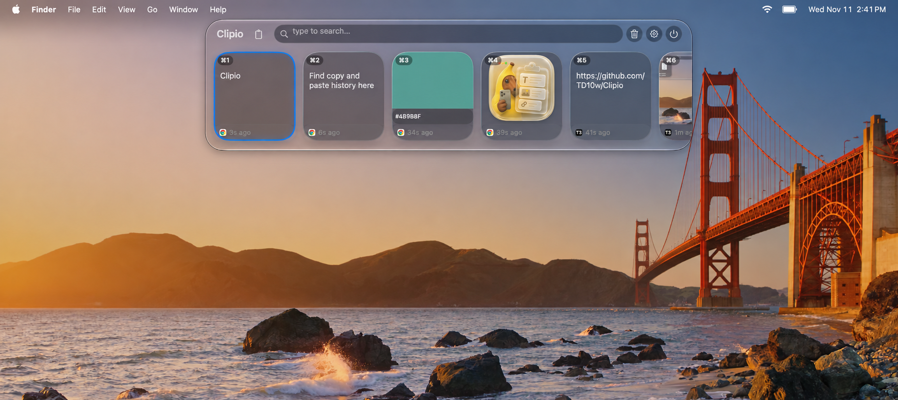
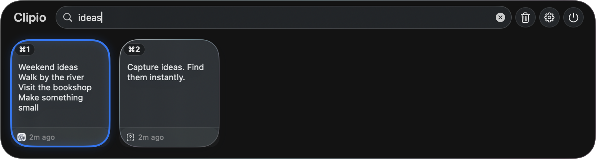

# Clipio

[English](README.md) · [简体中文](README.zh-CN.md)

A native macOS clipboard manager with a horizontal card shelf, built on [Maccy](https://github.com/p0deje/Maccy).

Browse copied text, images, files, and color values; search your history and pin items you use often. A second shelf, the **file collection**, holds files and images you drag in until you drag them out where they belong.

**[Download for macOS — 2.7.4-beta.1](https://github.com/TD10w/Clipio/releases/download/v2.7.4-beta.1/Clipio-2.7.4-beta.1.dmg)** · [Release notes](https://github.com/TD10w/Clipio/releases/tag/v2.7.4-beta.1)

macOS 14+ · Apple Silicon & Intel · Signed and notarized by Apple



*Clipio in dark appearance, shown with sample clipboard content.*



## Install

**Early public beta.** This is an independent personal project built on Maccy. No Xcode or terminal commands are needed to use the download.

1. [Download Clipio-2.7.4-beta.1.dmg](https://github.com/TD10w/Clipio/releases/download/v2.7.4-beta.1/Clipio-2.7.4-beta.1.dmg) and double-click it to open the installer. Choose this DMG, not GitHub's automatically generated “Source code” archives.
2. Drag **Clipio.app** into **Applications**, then open it. Confirm macOS's normal first-open prompt if shown.
3. Clipio runs in the **menu bar**; press **Shift + Command + V** for the clipboard shelf and **Shift + Command + C** for the file collection. It does not use a normal Dock window.
4. Copy something in another app to add it to history. Select a card with **Return**, then use **Command + V** in your destination app.
5. For automatic paste with **Option + Return**, allow Clipio in **System Settings → Privacy & Security → Accessibility**.

A short English guide appears on first launch. Reopen it from the gear menu → **Getting Started**, or Settings → General.

The DMG and optional ZIP are universal, Developer ID signed, Apple-notarized, and stapled. **Installation on a second Mac and the full UI checklist are still awaiting independent testing.** Please treat this as an early testing build and report problems.

**Upgrading from 2.6.1:** the clipboard shortcut is now **Shift + Command + V**; Shift + Command + C opens the file collection. Your clipboard history is kept. Both shortcuts can be changed in Settings.

Updates are manual: quit Clipio, download the next release, and replace the app in Applications. If automatic paste fails after an update, check Accessibility permission again. There is no Clipio Homebrew command or Mac App Store release offered by this project.

If macOS refuses to open the download, check the macOS 14+ requirement and download it again from this repository. Report the exact error in [Issues](https://github.com/TD10w/Clipio/issues/new/choose); do not disable Gatekeeper globally.

Optional checksum verification is documented in the [release notes](https://github.com/TD10w/Clipio/releases/tag/v2.7.4-beta.1).

## Using Clipio

Clipio runs in the menu bar. Copy something in another app, then open its shelf.

| Default shortcut | Action |
| --- | --- |
| Shift + Command + V | Open the clipboard shelf |
| Shift + Command + C | Open the file collection |
| Tab | Switch between clipboard and file collection |
| Type while the shelf is open | Search the current shelf |
| Return | Copy the selected item; use Command + V in the destination app |
| Option + Return | Paste into the active app |
| Option + P | Pin or unpin the selected item |
| Escape | Close the shelf |

These are default settings. Enabling “paste by default” changes Return behavior. Hover over a card for a preview. Settings also control appearance (including a **Transparency** slider, clearer to the left, more frosted to the right), history size, ignored apps, and search behavior.

### File collection

A place to park files on their way somewhere else.

- **Drag in:** start dragging files, folders, or images from a browser. A small glass pill appears at the top of the screen; drop onto it. Rest there about half a second and it opens the full collection.
- **Drag out:** dragging an ordinary item into Finder **moves** the original, and the card disappears. **Pin** an item first to **copy** it instead and keep it. Cancelled drags, name conflicts, and a folder containing a pinned item are all protected.
- **Stacks:** files dropped together stay together as one stacked card with a count. Click to expand, click ‹ to collapse. Collapsed, dragging and pinning act on the whole Stack; expanded, on single items.
- Items stay after quitting. Search covers file names; a match inside a Stack shows the whole Stack.

### Permissions

Automatic paste needs **System Settings → Privacy & Security → Accessibility → Clipio**. Copying an item and pasting manually with Command + V does not need this permission. If automatic paste stops working after replacing a local build, check its Accessibility entry again.

## Privacy and storage

Clipboard history is stored locally with SwiftData. The current app does not implement cloud sync or analytics. History persists between launches by default; the default history limit is 200, and pinned items are retained separately from ordinary eviction.

Local storage is **not a password vault**. There is no app-level database encryption. Clipio skips supported concealed/transient clipboard markers, but cannot identify every password or secret copied as ordinary text. Configure ignored apps or pause capture before copying sensitive content. Clearing history and clearing the system clipboard are separate settings.

The file collection keeps **references** to local files rather than copies; images dragged in from a browser are saved inside Clipio's own app data on this Mac. Removing or clearing collection items never deletes the original files.

Do not attach clipboard databases, complete settings dumps, passwords, tokens, or unredacted screen recordings to public issues.

## Testing and feedback

Report bugs in [Clipio Issues](https://github.com/TD10w/Clipio/issues/new/choose), in English or Chinese. Include your Clipio version or commit, macOS version, Apple Silicon/Intel, reproduction steps, and expected versus actual behavior. Use sample content in screenshots.

Useful first tests: text/image copy, search, pinning, dragging files into and out of the file collection (moving vs. pinned copying, Stacks), paste with and without Accessibility access, clear-history confirmation, and copying beyond the history limit.

Known limitations:

- Early testing build; updates are manual. Second-Mac installation and full UI verification remain outstanding.
- Image/file dragging can depend on the destination app; report concrete examples of failures.
- File collection: moving files to another disk, behavior after a system restart, and dragging across multiple displays have not been verified yet.
- New UI text is not fully localized, and the accessibility permission prompt is English only.
- Database startup failure recovery and a flaky automated window-lifecycle test still need follow-up. Do not use the clipboard history as your only copy of important content.

## Build from source (optional)

Requires macOS 14 Sonoma or later and full Xcode (Command Line Tools alone are insufficient). Use an Xcode version compatible with your macOS; allow Xcode to resolve the pinned Swift packages on the first build.

```bash
git clone https://github.com/TD10w/Clipio.git
cd Clipio
open Clipio.xcodeproj
```

Select the **Clipio** scheme, choose **My Mac**, and run. If Xcode requests signing, select your own development team in Signing & Capabilities.

To build an optimized app for your own Mac without installing it:

```bash
./scripts/release-local.sh --build-only
open build/LocalRelease/Build/Products/Release/Clipio.app
```

This locally signed build is not a notarized download for distribution to other Macs. Maintainers should use the [release checklist](docs/public-beta-checklist.md).

Current source verification, outstanding acceptance work, and design follow-up are tracked in the [project handoff](docs/beta-readiness-handoff.md).

## Demo and credits

The [demo source](Designs/Clipio-Demo/README.md) contains a 20-second reconstructed product animation, not a live recording. A reviewed export is not published yet. Legacy Maccy App Store assets are not demonstrations of the current Clipio UI.

Clipio builds on Maccy by Alex Rodionov and its contributors. Upstream copyright notices, source references, internal names, and storage compatibility names are intentionally retained. Please report Clipio-specific problems here, not to upstream Maccy.

Code is available under the [MIT license](LICENSE). Third-party media and fonts need their own attribution and redistribution checks; see [media notes](docs/media-notes.md).
