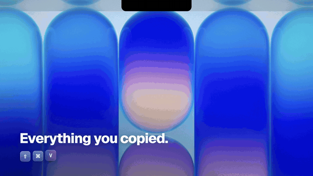
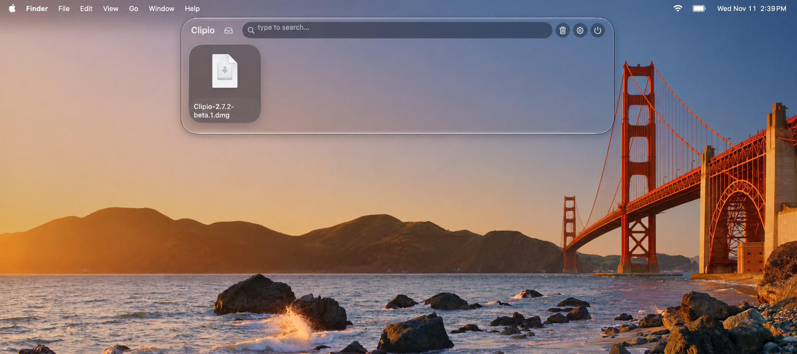

# Clipio

[English](README.md) · [简体中文](README.zh-CN.md)

**Find what you copied. Gather what you want to move.**

Clipio is a native macOS clipboard manager with a horizontal card shelf and a file collection area. Search copied text, images, links and colors, then collect files from different places before dragging them to their destination.

**[Download version 2.9.1 (.dmg)](https://github.com/TD10w/Clipio/releases/download/v2.9.1/Clipio-2.9.1.dmg)** · [Release notes](https://github.com/TD10w/Clipio/releases/latest)

Open the downloaded DMG, then drag **Clipio.app** into **Applications**.

macOS 14+ · Apple Silicon & Intel · Signed and notarized · Free and open source

*30-second demo · silent preview*

## Clipboard

Find a link you copied earlier, preview an image, or reuse a text snippet without going back to the source app. Type to search the shelf, hover over a card to preview it, and star items you use often to find them in Favorites.

Press **Shift + Command + V** to open the shelf. Select a card with **Return**, then paste with **Command + V**.

## File collection

Gather files from different folders before dropping them into a Finder folder or another app. Drag files, folders or images onto the **Drop Zone** at the top of your screen. Files dropped together form a **Stack**; click to expand it. Press **Tab** to switch between clipboard and collection.

Dragging an ordinary collection item into Finder moves the original. **Pin** it first to copy it instead and keep it in the collection.

## Get started

1. Download and open the DMG, then drag **Clipio.app** into **Applications**.
2. Open Clipio. It runs in the **menu bar**, and a short guide walks you through choosing a shortcut and trying it once.
3. Copy something, then press **Shift + Command + V** to open your clipboard history.
4. Select a card with **Return**. Clipio pastes it where you were typing if you allowed automatic paste in the guide; otherwise press **Command + V**.
5. Try file collection: drag a few sample files together onto the Drop Zone, click the Stack to expand it, then drag a file into a Finder folder. Ordinary files move; pin them first if you want copies.

No Xcode or terminal commands are needed to use the download.

Automatic paste needs Clipio switched on in **System Settings → Privacy & Security → Accessibility**. The guide takes you there; if Clipio is not in the list, click **+** and choose it. Reopen the guide any time from the gear menu → **Getting Started**.

## Shortcuts

| Shortcut | Action |
| --- | --- |
| Shift + Command + V | Open clipboard history |
| Shift + Command + C | Open file collection |
| Tab | Switch shelves |
| Return | Copy the selected clipboard item |
| Option + Return | Paste into the active app |
| Option + P | Favorite a clipboard item / pin a collection item |
| Escape | Close the shelf |

These are defaults; shortcuts and paste behavior can be changed in Settings.

## Privacy

Clipboard history stays on your Mac. There is no cloud sync or analytics, and no app-level history encryption. Use ignored apps or pause capture before copying sensitive content.

The collection references ordinary local files. Browser images and supported files from app-private locations are saved as local copies in Clipio's app data; their source files are preserved. Removing an item from the collection does not delete its original file. Keep separate copies of important material. See [import limits and file behavior](docs/usage.md#file-collection).

## Updates and feedback

The official download supports in-app updates from **Settings → General → Check now**. You can also quit Clipio, download the new version, and replace the app in Applications.

Known limits: file dragging can vary by destination app; cross-disk moves and multi-display dragging have not yet been verified. Some interface text is English only.

Trying Clipio for the first time? Tell us what you used it for, what worked, and where you got stuck. [Share feedback or report an issue](https://github.com/TD10w/Clipio/issues/new/choose) with your Clipio version, macOS version and steps to reproduce a problem. Use sample content in screenshots.

[More usage and troubleshooting](docs/usage.md) · [Build from source](docs/development.md)

## Credits

Designed and developed by [TD10w](https://github.com/TD10w). Built on [Maccy](https://github.com/p0deje/Maccy) by Alex Rodionov and its contributors. Code is available under the [MIT license](LICENSE).
