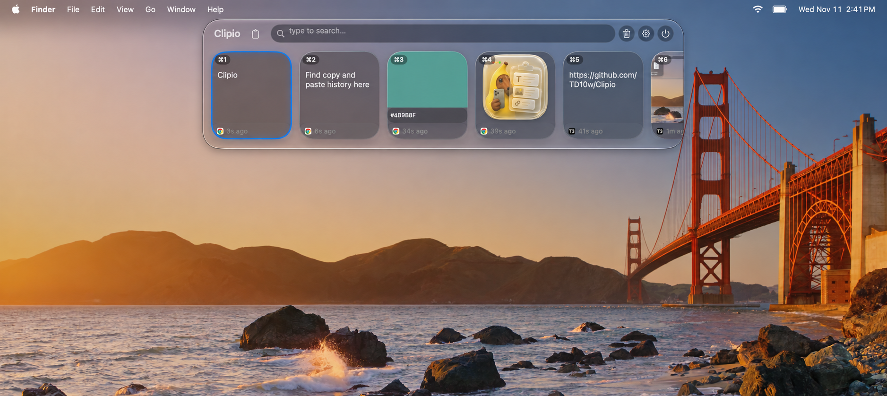
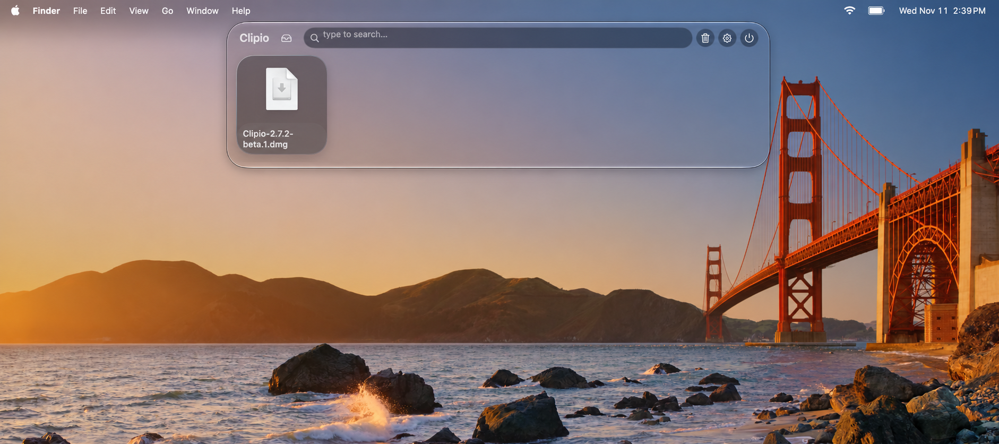

# Clipio

[English](README.md) · [简体中文](README.zh-CN.md)

一款原生 macOS 剪贴板与文件收集工具。找回复制过的内容，留住常用项，把准备移到别处的文件先收在一起。

**[下载 macOS 测试版 — 2.8.3-beta.1](https://github.com/TD10w/Clipio/releases/download/v2.8.3-beta.1/Clipio-2.8.3-beta.1.dmg)** · [版本说明](https://github.com/TD10w/Clipio/releases/tag/v2.8.3-beta.1)

macOS 14+ · Apple Silicon 和 Intel · 已签名并通过 Apple 公证 · 早期公开测试版

## 剪贴板

用横向卡片浏览复制过的文字、图片、链接和颜色。输入文字即可搜索，悬停查看预览，常用内容可以置顶。

## 文件收集区

把文件、文件夹或图片拖到屏幕上方的 **Drop Zone**。一次放入的多个文件会叠成一个 **Stack**，点一下即可展开。按 **Tab** 在剪贴板和收集区之间切换。

普通收集项拖到 Finder 会移动原文件；先 **Pin** 再拖出，则会复制文件，并保留收集项。

## 开始使用

1. 下载并打开 DMG，将 **Clipio.app** 拖入“**应用程序**”。
2. 打开 Clipio，它会在**菜单栏**运行。
3. 复制一些内容，按 **Shift + Command + V** 打开剪贴板历史。
4. 选中卡片按 **Return**，再到目标应用按 **Command + V** 粘贴。

如需用 **Option + Return** 自动粘贴，请在**系统设置 → 隐私与安全性 → 辅助功能**中允许 Clipio。首次上手指南也可从齿轮菜单 → **Getting Started** 重新查看。

## 快捷键

| 快捷键 | 功能 |
| --- | --- |
| Shift + Command + V | 打开剪贴板历史 |
| Shift + Command + C | 打开文件收集区 |
| Tab | 切换剪贴板与收集区 |
| Return | 复制选中的剪贴板内容 |
| Option + Return | 粘贴到当前应用 |
| Option + P | 置顶或取消置顶 |
| Escape | 关闭卡片栏 |

以上为默认设置；快捷键和粘贴行为都可以在设置中修改。

## 隐私

剪贴板历史保存在你的 Mac 上，没有云同步或使用分析，也没有应用层历史加密。复制敏感内容前，可以设置忽略相关应用或暂停记录。

收集区保存本地文件的引用；从浏览器拖入的图片保存在 Clipio 的本机数据中。移除收集项不会删除原文件。重要内容请另留副本。

## 更新与反馈

当前采用手动更新：退出 Clipio，下载新版本，再替换“应用程序”里的旧版本。

这是早期测试版。文件拖拽可能受目标应用影响，跨磁盘移动和跨显示器拖拽尚未验证；部分界面文字目前仅有英文。

[反馈问题](https://github.com/TD10w/Clipio/issues/new/choose)时，请附上 Clipio 版本、macOS 版本和复现步骤。截图请使用示例内容。

[更多用法与常见问题](docs/usage.zh-CN.md) · [从源码构建](docs/development.md)

## 致谢

由 [TD10w](https://github.com/TD10w) 设计和开发，基于 Alex Rodionov 及贡献者的 [Maccy](https://github.com/p0deje/Maccy)。代码采用 [MIT 许可证](LICENSE)。
